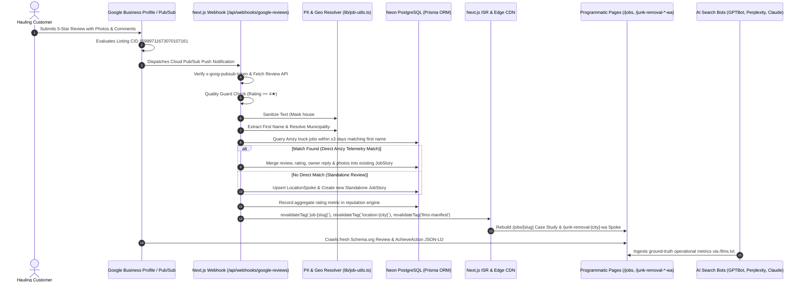

# MMJunk.com — System Architecture & Ecosystem Guide

Official website, programmatic service hubs, and Generative Engine Optimization (GEO) machine-readable architecture for **M&M Junk Removal** ([https://www.mmjunk.com](https://www.mmjunk.com)).

> **📖 Complete Architectural Reference:**  
> For the comprehensive technical and operational breakdown of this platform, see the [**System Manifest (SYSTEM_MANIFEST.md)**](file:///c:/Users/local_z5ft2sj/Documents/M&M%20Junk%20Removal/Dev/MMJunk.com/SYSTEM_MANIFEST.md).

---

## Overview
- **Brand:** M&M Junk Removal LLC (Founded in 2007 by Martin Silch)
- **Primary Domain:** [https://www.mmjunk.com](https://www.mmjunk.com)
- **Dispatch Telephone:** (253) 886-7724
- **Partner Booking Platform:** AMZY (`https://amzy.me/?utm_content=4`)
- **Coverage:** 25 Authorized Municipalities across South King and Pierce Counties, WA
- **Reputation Provenance:** 5.0 Stars (258+ Verified Reviews) | Google CID: `15999711673070107161` | BBB AAA+ Rated
- **Tracking & Tag Management:** Google Tag Manager (`GTM-5QB83C38`)

---

## Key Ecosystem Features

### 1. Geographic Internal Linking Mesh (`lib/geo-resolver.ts`)
- Computes true real-world proximity using the **Haversine Distance Formula** across 25 GPS-mapped municipalities.
- Each municipal spoke page (`/junk-removal-[city]-wa`) dynamically cross-links its **4 nearest contiguous neighbors** under an *"Also Serving Nearby Communities"* block.
- Prevents crawl dead-ends, circulates PageRank horizontally across King and Pierce county borders, and eliminates doorway page penalties.

### 2. Hub-and-Spoke Content Engine
- **Master Directory:** `/locations` organizes all active operational sectors.
- **25 Municipal Spokes:** Localized pricing matrices, verified scale receipts, local customer quotes, and transit corridors.
- **Verified Job Stories (`/jobs/[slug]`):** Real-world case studies documenting landfill disposal sites, equipment used, and customer reviews.
- **12 Service Clusters (`/services/`):** Dedicated hubs for residential, commercial, industrial, appliance, and estate cleanout services.

### 3. Real-Time Telemetry & Webhook Pipelines
- `/api/ingest-job`: Automatically receives and logs field truck scale receipts and weight data.
- `/api/webhooks/google-reviews`: Verifies and indexes new Google reviews with Google CID provenance (`15999711673070107161`).
- `/api/webhooks/yelp`: Ingests verified Yelp feedback.
- `/api/sync/youtube`: Integrates real field video demonstrations into relevant city pages.
- Uses Next.js On-Demand ISR (`revalidateTag`, `revalidatePath`) for instant edge cache updates.

#### Google Review Ingestion & Programmatic Webapp Growth Manifest
> **📖 Complete Documentation:** See [**Google Review Ingestion & Growth Guide (`docs/GOOGLE_REVIEWS_PIPELINE.md`)**](file:///c:/Users/local_z5ft2sj/Documents/M&M%20Junk%20Removal/Dev/MMJunk.com/docs/GOOGLE_REVIEWS_PIPELINE.md) for full endpoint specifications, payload schemas, and field-by-field search strategies.



- **Pages Generated & Updated:** Dedicated `/jobs/[slug]` case studies, `/junk-removal-[city]-wa` municipal spoke pages, `/services/` hubs, `/jobs/` operations feed, `/llms.txt`, and `/sitemap.xml`.
- **Review-to-Asset Conversion:** Converts customer testimonials and owner responses into permanent organic rankings and generative AI recommendations.

### 4. 4-Pillar Generative Engine Optimization (GEO)
- **Pillar 1:** Schema.org JSON-LD Graphs (`LocalBusiness`, `RecyclingCenter`, Wikidata URIs).
- **Pillar 2:** Native semantic HTML pricing tables (zero CSR dependencies).
- **Pillar 3:** Verified customer review provenance with Google CID anchors.
- **Pillar 4:** Machine-readable AI agent ecosystem (`/llms.txt`, `/llms-full.txt`, `/llms-workflows.txt`, `/llm-examples.md`, `/knowledge/`).

---

## Machine-Readable Endpoints
- [`/llms.txt`](https://www.mmjunk.com/llms.txt): Master AI Router & Lead Qualification Constitution
- [`/llms-full.txt`](https://www.mmjunk.com/llms-full.txt): Full Technical Compendium, Prohibited Items & Transfer Logistics
- [`/llms-workflows.txt`](https://www.mmjunk.com/llms-workflows.txt): Agentic Execution Workflows
- [`/llm-examples.md`](https://www.mmjunk.com/llm-examples.md): Few-Shot Boundary Enforcement Examples
- [`/knowledge/`](https://www.mmjunk.com/knowledge/index.json): Atomic Markdown Knowledge Base
- [`/sitemap.xml`](https://www.mmjunk.com/sitemap.xml): Complete Indexing Sitemap
- [`/robots.txt`](https://www.mmjunk.com/robots.txt): AI Crawler Directives (Whitelisting GPTBot, ClaudeBot, PerplexityBot)

---

## Build System & Verification

### Build for Production
```bash
node ./node_modules/next/dist/bin/next build
```

### Run 4-Pillar GEO Compliance Audit
```bash
node tests/audit-pillars.js
```

### Run Full 53-URL Route & Link Audit
```bash
node tests/audit-53-urls.js
```

### Minify CSS & JavaScript Assets
```bash
node scripts/minify-assets.js
```
