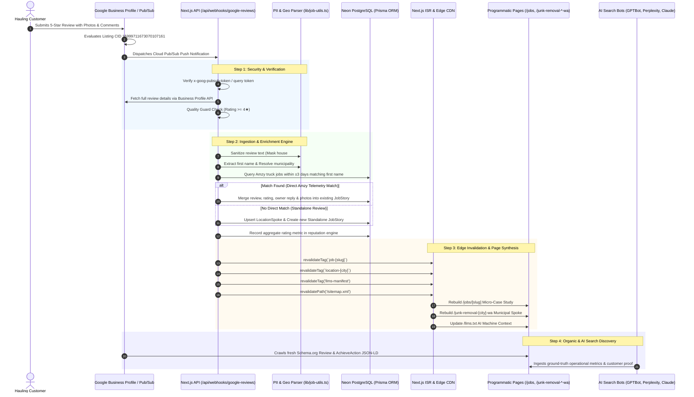
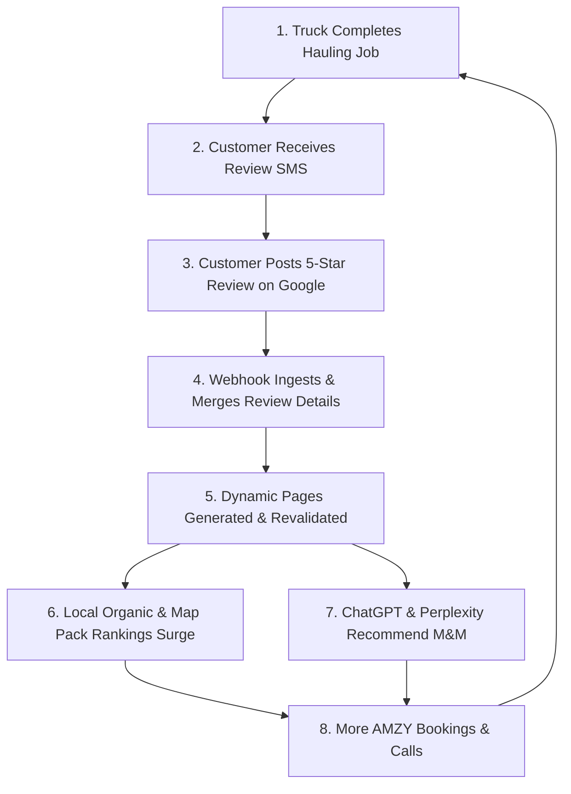

# Google Review Ingestion Manifest & Programmatic Growth Architecture (Pillar 3)

This document specifies the complete end-to-end architecture for Google Business Profile (GBP) review ingestion, automated telemetry fusion, and programmatic webapp growth for **M&M Junk Removal** ([https://www.mmjunk.com](https://www.mmjunk.com)).

---

## 1. Executive Summary & Purpose

Customer reviews on Google are typically treated as passive marketing proof displayed only on third-party maps or in static home page carousels. At M&M Junk Removal, incoming Google reviews operate as **dynamic, programmatic SEO assets**. 

Every verified 5-star or 4-star Google review triggers an automated serverless pipeline that:
1. **Validates & Sanitizes** the review data (filtering low ratings, redacting personal identifiable information, and masking exact residential numbers).
2. **Matches & Fuses** customer testimonials with real-world field hauling truck telemetry (scale tickets, dump disposal facilities, truck equipment, tonnage).
3. **Programmatically Generates & Enriches** multiple webapp destinations: dedicated micro-case studies (`/jobs/[slug]`), municipal spoke hubs (`/junk-removal-[city]-wa`), and service hubs (`/services/`).
4. **Feeds Machine-Readable AI Indices** (`/llms.txt`, `/llms-full.txt`, `knowledge/reputation.json`) consumed by conversational AI search engines (ChatGPT Search, Perplexity, Claude, Google AI Overviews).
5. **Instantly Invalidates Vercel Edge Caches** via on-demand Incremental Static Regeneration (ISR) tags.

---

## 2. Ingestion & Growth Sequence Architecture



---

## 3. Webhook Technical Specifications

### Endpoint Details
* **Canonical URL:** `https://www.mmjunk.com/api/webhooks/google-reviews`
* **HTTP Method:** `POST` (Supports `GET` for liveness checks)
* **Authentication:** 
  * Query param: `?token=<GOOGLE_PUBSUB_VERIFICATION_TOKEN>`
  * Header: `x-goog-pubsub-token: <GOOGLE_PUBSUB_VERIFICATION_TOKEN>`

### Cloud Pub/Sub Payload Envelope
Google Cloud Pub/Sub dispatches notifications wrapped in base64-encoded envelopes:
```json
{
  "message": {
    "data": "eyJldmVudFR5cGUiOiJORVdfUkVWSUVXIiwicmVzb3VyY2VOYW1lIjoiYWNjb3VudHMvMTEyMjMzNDQ1NS9sb2NhdGlvbnMvOTk4ODc3NjY1NS9yZXZpZXdzL2FiYzEyMyJ9",
    "messageId": "136969346945",
    "publishTime": "2026-10-26T22:30:00Z"
  },
  "subscription": "projects/mmjunk-reviews/subscriptions/gmb-reviews-sub"
}
```

Decoded `data` JSON schema:
```json
{
  "eventType": "NEW_REVIEW",
  "resourceName": "accounts/1122334455/locations/9988776655/reviews/abc123xyz"
}
```

---

## 4. What Pages Are Built & Enriched from Ingested Reviews

Every ingested review dynamically powers **6 distinct layers of the webapp**:

### Layer 1: Dedicated Micro-Case Study Pages (`/jobs/[slug]`)
* **URL Structure:** `https://www.mmjunk.com/jobs/[service-type]-[city]-[jobId]`  
  *(e.g., `https://www.mmjunk.com/jobs/commercial-appliance-removal-auburn-98421` or `https://www.mmjunk.com/jobs/light-demolition-shed-teardown-renton-8819`)*
* **Page Contents:**
  * **Top Operational Banner:** Displays scale ticket log ID (`Log ID: WA-ALG-2026-8819`), completion date, and verified city.
  * **Verified Field Telemetry:** Scale weight (e.g. `2,840 lbs`), truck equipment used (`16-ft Box Truck, Hydraulic Liftgate`), and certified disposal/recycling facility (`King County Bow Lake Transfer Station`).
  * **Customer Review Block:** Star rating badge (★ 5.0), reviewer first name, verified review platform badge ("Google Verified Review"), and sanitized testimonial.
  * **Owner's Technical Response:** Martin Silch's operational explanation detailing safety procedures, recycling protocols, and truck capacity.
  * **Visual Proof Gallery:** Customer-submitted before/after photos and dispatch crew photos tagged with Schema.org `ImageObject`.
  * **Dual Conversion Triggers:** Direct link to [AMZY Live Booking Calendar](https://amzy.me/?utm_content=4) (`?utm_content=4`) and direct telephone dispatch (`(253) 886-7724`).
* **Structured Data:** Deeply nested Schema.org `@graph` containing `LocalBusiness`, `Service`, `AchieveAction`, `Review` (with author and publisher CID `15999711673070107161`), `Comment` (owner reply), and `ImageObject`.

### Layer 2: Municipal Spoke Landing Pages (`/junk-removal-[city]-wa`)
* **URL Structure:** `https://www.mmjunk.com/junk-removal-[city]-wa` across all 25 authorized municipalities.
* **Dynamic Injections:**
  1. **"Customer-Verified Hauling Records in [City]" Table:**
     * Injects the job as a permanent row containing: Service Type (linking to `/jobs/[slug]`), Neighborhood anchor, Disposal Transfer Station, and Scale Weight.
  2. **"Featured Project Proof & Before/After in [City]" Section:**
     * If the review or matched dispatch contains photos, it automatically renders an interactive card showing visual evidence of work done in that exact city with a link to the full case study.
  3. **Verified Local Testimonial Block:**
     * Displays the customer quote, star rating, and first name as local social proof for homeowners searching in that municipality.
  4. **Schema.org Graph Invalidation:**
     * Inserts the job's `AchieveAction` into the spoke's semantic graph, strengthening the municipality's geographic entity containment.

### Layer 3: Master Service Landing Pages (`/services/`)
* **Relevant Pages:**
  * [Light Demolition Services](file:///c:/Users/local_z5ft2sj/Documents/M&M%20Junk%20Removal/Dev/MMJunk.com/services/light-demolition-services/index.html) (`/services/light-demolition-services`)
  * [Hot Tub Demolition & Removal](file:///c:/Users/local_z5ft2sj/Documents/M&M%20Junk%20Removal/Dev/MMJunk.com/services/hot-tub-demolition-removal/index.html) (`/services/hot-tub-demolition-removal`)
  * [Residential Hauling Hub](file:///c:/Users/local_z5ft2sj/Documents/M&M%20Junk%20Removal/Dev/MMJunk.com/services/residential/index.html) (`/services/residential/`)
  * [Commercial Cleanouts](file:///c:/Users/local_z5ft2sj/Documents/M&M%20Junk%20Removal/Dev/MMJunk.com/services/commercial/index.html) (`/services/commercial/`)
* **Enrichment:**
  * Reviews mentioning specialized items (e.g. "hot tub", "shed", "refrigerator", "concrete", "drywall") are linked to that service category, providing fresh proof vectors and user testimonials.

### Layer 4: Completed Jobs Operations Feed (`/jobs/`)
* Chronological archive of all verified hauling records across King and Pierce counties.
* Automatically incorporates newly ingested case studies, expanding the site's indexable page count and internal link graph.

### Layer 5: Machine-Readable AI Endpoints (`/llms.txt`, `/llms-full.txt`, `knowledge/reputation.json`)
* **Dynamic AI Router:** Updates `/llms.txt` with latest completion summaries (e.g., `- [Renton, WA Operations](...): 18 verified telemetry actions. Latest completion: Light Demolition (Shed & Wall Teardown).`).
* **Reputation Graph (`knowledge/reputation.json`):** Incrementally updates the aggregate star rating, review counts, and platform breakdowns for AI search scrapers (Perplexity, ChatGPT, Claude) without requiring HTML re-parsing.

### Layer 6: Root Sitemap (`/sitemap.xml`)
* Automatically registers the new `/jobs/[slug]` case study URL with `<priority>0.7</priority>` and `<lastmod>` set to the completion timestamp, notifying Googlebot for rapid indexation.

---

## 5. Field-by-Field Logic & Strategy

| Fetched Review Field | Ingestion & Processing Logic | Programmatic Webapp Growth & Search Strategy |
| :--- | :--- | :--- |
| **`starRating`** | **Quality Guard:** Only reviews with **4 or 5 stars** are published as case studies. Reviews below 4 stars are suppressed from public SEO generation and logged internally for service resolution. | Prevents negative or unconstructive feedback from diluting algorithmic ranking authority or generating poor landing pages, while ensuring only top-tier proof is indexed. |
| **`comment`** | **PII & Address Sanitizer:** <br>1. Phone numbers and emails are redacted (`[phone hidden]`, `[email hidden]`).<br>2. Exact house numbers are masked while street names and avenues are preserved (`lib/job-utils.ts`). | **High-Intent Long-Tail Keywords:** Real customers naturally use phrasing that prospective customers search for (e.g., *"cut up an old cedar hot tub on my patio without damaging the fence"*). Preserving street names captures hyper-local neighborhood search intent without violating customer privacy. |
| **`reviewerName`** | **First Name Extraction:** Extracts only the customer's first name (`extractFirstName()`). | Used to match incoming reviews against field truck telemetry within a ±3 day window. Publicly renders as "Sarah J." or "David" to guarantee consumer privacy while maintaining verifiable authenticity. |
| **`photos`** | **Visual Asset Ingestion:** Extracts Google photo URLs and appends them to the job's `mediaUrls` array. | Auto-generates Schema.org `ImageObject` tags with contextual descriptions (`"[Service] in [City], WA - Operational Field Proof Photo"`). Ranks directly in Google Image Search and powers the visual Before/After showcase on city pages. |
| **`ownerReply`** | **Technical Semantic Amplification:** Captures Martin Silch's response from Google Business Profile. | **The Generative AI Secret Weapon:** Customers often leave short reviews (*"Great job!"*). The owner's reply provides technical vectors: truck dimensions (16-ft box truck), hydraulic equipment, disposal sites (DTG, Bow Lake), and recycling compliance. AI search engines cross-encode both texts to confirm verified operational capabilities. |
| **`createTime`** | **90-Day Freshness Qualification:** Evaluates review age against Google's local freshness decay curve. | Guarantees that municipal spoke pages always display fresh social proof, signaling to Googlebot and AI crawlers that M&M Junk Removal maintains continuous, active daily operations in that municipality. |
| **`geoResolver`** | **Geographic Anchor Resolution:** Scans review text for city names and ZIP codes (`resolveMunicipality()`). Falls back to dispatch coordinates or Federal Way HQ. | Anchors the case study to one of the 25 authorized municipal spokes (`AUTHORIZED_MUNICIPALITIES`), nesting Wikidata QIDs, county jurisdiction, and local transfer station compliance into the page schema. |

---

## 6. Match & Merge Engine: Fusing Telemetry with Social Proof

The core algorithmic differentiator of the M&M Junk Removal platform is the **Match & Merge Engine**:

```
                       ┌────────────────────────────┐
                       │  Amzy Hauling Telemetry   │
                       │  - Scale Ticket: 3,120 lbs │
                       │  - Facility: Algona Depot  │
                       │  - Truck: 16-ft Box Truck  │
                       │  - Customer: "Sarah J."    │
                       └─────────────┬──────────────┘
                                     │
                                     ▼
                      ┌──────────────────────────────┐
                      │    Match & Merge Engine      │
                      │   (±3 Day Window Lookup)     │
                      └──────────────┬───────────────┘
                                     │
                                     ▲
                       ┌─────────────┴──────────────┐
                       │    Google Business Review   │
                       │    - Reviewer: "Sarah J."   │
                       │    - Rating: 5 Stars        │
                       │    - Comment: "Great job!"  │
                       │    - Photos: Before/After   │
                       └────────────────────────────┘
                                     │
                                     ▼
                    ┌───────────────────────────────────┐
                    │ Unified Authority Asset           │
                    │ /jobs/shed-demolition-auburn-8819 │
                    │ - Real Scale Ticket Proof         │
                    │ - Verified 5-Star Customer Review │
                    │ - Martin's Technical Reply        │
                    │ - High-Res Field Proof Photos     │
                    │ - Schema.org AchieveAction+Review │
                    └───────────────────────────────────┘
```

1. When a truck finishes a job, AMZY logs an unreviewed `JobStory` containing weight tickets and equipment data.
2. When the customer leaves a Google review within 72 hours, the webhook matches the customer's first name.
3. The record is updated into a complete **Unified Authority Asset**, combining hard mathematical field proof (weight tickets) with verified human emotional proof (5-star review).

---

## 7. The Programmatic SEO & AI Search Flywheel



### Why This Outranks Competitors
1. **Google Information Gain:** Standard SEO competitors copy-paste generic lists of services. M&M Junk Removal publishes unique, empirical field logs that Google's Information Gain scoring heavily rewards.
2. **Zero Duplicate Content:** Because every review contains authentic customer phrasing and custom owner responses, each generated `/jobs/[slug]` page is 100% unique in copy, semantic structure, and visual proof.
3. **Generative Engine Optimization (GEO):** LLMs crawl `/llms.txt`, `/llms-full.txt`, and structured `Review` + `AchieveAction` graphs. When a user asks ChatGPT: *"Who can dismantle an old shed in Auburn, WA?"*, M&M Junk Removal is cited with exact scale receipts, customer confirmation, and direct booking links.

---

## 8. Verification & Auditing Commands

To verify webhook routes, edge cache invalidation, and 4-Pillar compliance:

```bash
# Test Webhook Liveness
curl.exe -s "https://www.mmjunk.com/api/webhooks/google-reviews"

# Run 4-Pillar GEO Compliance Audit
node tests/audit-pillars.js

# Run Full 53-URL Route & Link Audit
node tests/audit-53-urls.js
```
